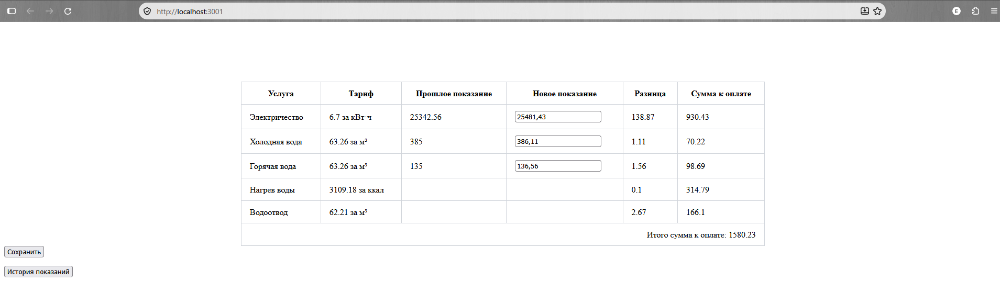

# Квартплата

Утилита для расчёта квартплаты по показаниям счётчиков — с гибким конфигом, историей показаний и итоговой суммой, которую можно показать арендатору.




---

## Что это и зачем

Раз в месяц нужно снять показания счётчиков (электричество, холодная и горячая вода), посчитать разницу с прошлым месяцем, умножить на тарифы и сложить с производными услугами (нагрев воды, водоотвод). Руками — долго и легко ошибиться. Таблица в экселе - лучше, но не намного. Эта утилита делает это за пару секунд: можно ввести новые показания — сразу видно разницу, стоимость по каждой услуге и итог. По кнопке «Сохранить» запись уходит в историю, чтобы потом было чем сверяться с арендатором.

---

## Как это работает

1. Пользователь вводит новые показания счётчиков.
2. Утилита берёт прошлые значения из `readings.json`, считает разницу, применяет тарифы из `config.json` и считает производные услуги по формулам оттуда же.
3. Показывает таблицу: разница и стоимость по каждой услуге + итог.
4. По кнопке «Сохранить» новая запись добавляется в историю.

---

## Гибкость и расширяемость

Утилита не привязана к жёсткому набору услуг. Вся конфигурация — названия, тарифы, единицы измерения и **формулы** — вынесена в `config.json`. Добавление новой услуги не требует правки кода.

Например, если электричество разделится на дневной и ночной тариф — достаточно добавить две записи в `config.json`:

```json
"electricity_day":   { "name": "Электричество (день)",   "unit": "кВт·ч", "price": 7.10, "type": "meter", "field": "electricity_day" },
"electricity_night": { "name": "Электричество (ночь)",   "unit": "кВт·ч", "price": 4.20, "type": "meter", "field": "electricity_night" }
```

Код при этом не меняется: форма и таблица строятся динамически из конфига, расчёт обходит все услуги циклом.

Почему было не захардкодить все? Да, это решило бы задачу для одного меня. Так это решает класс задач для любого, кому это может понадобиться.

---

##  Логика расчёта

Все услуги делятся на два типа:

- **`meter`** — счётчик. Значение считается как разница между текущим и прошлым показанием. Примеры: электричество, холодная вода, горячая вода.
- **`derived`** — производная услуга. Значение считается по формуле из конфига на основе уже посчитанных разниц. Примеры: нагрев воды (`"formula": "diff_water_hot * 0.0649"`), водоотвод (`"formula": "diff_water_cold + diff_water_hot`).

Расчёт идёт **в два прохода**:

1. **Сбор разниц (`diff`)**. Для каждой `meter`-услуги вычисляется разница между текущим и прошлым показанием.
2. **Производные и стоимости**. Для каждой `derived`-услуги формула из конфига вычисляется на основе уже готовых разниц. Затем для всех услуг считается стоимость и итог.

Два прохода гарантируют, что производные всегда считаются от актуальных разниц, а не от устаревших. При изменении одного счётчика пересчитываются все зависимые от него услуги — итог всегда консистентен.

---

## Стек

- **Node.js + Express** — мини-сервер для расчётов и отдачи интерфейса.
- **Bun `--compile`** — сборка в один `.exe`, без установки Node.js на машине пользователя.
- **JSON-конфиг** — тарифы и формулы вынесены из кода. Меняются без пересборки.
- **[@emmetio/math-expression](https://github.com/emmetio/math-expression)** (MIT) — крошечный (меньше 2 КБ) безопасный парсер математических выражений. Используется для вычисления формул из `config.json` **без `eval()`**.

---

##  Использование

1. Скачайте [`kvartplata.exe`](../../releases/latest) и положи рядом `config.json` и `readings.json`.
2. Запусти `kvartplata.exe` — откроется браузер с интерфейсом.
3. Введи показания, посмотри расчёт, нажми «Сохранить».

### Сборка из исходников

```bash
npm install
bun build ./server.js --compile --target=bun-windows-x64 --minify --outfile kvartplata.exe
```

Рядом с `.exe` должны лежать `config.json` и `readings.json` (если истории ещё нет — пустой массив `[]`).

---

##  Структура проекта

```
kvartplata/
├── server.js          # Express-сервер + calculate()
├── index.html         # интерфейс (форма, таблица, история)
├── config.json        # тарифы, названия, формулы
├── readings.json      # история показаний
└── package.json
```

---

## Известные ограничения

- Окно — вкладка браузера, а не нативное приложение.
- При смене схемы тарифов (например, разделение электричества на день/ночь) старые показания могут потребовать ручной миграции.
- Формулы в конфиге используют ограниченный синтаксис (`@emmetio/math-expression`): арифметика, скобки, переменные вида `diff_<key>`. Условий и функций там нет, это и хорошо.
- Для расчета подходят только показания по счетчикам и производные от них, производные от производных посчитать не выйдет.

---

## Чему я научился на этом проекте
### Работа с файловой системой (`fs`)
- Чтение и запись файлов через `readFileSync` / `writeFileSync`
- **рабочая директория** `process.cwd()`
- `path.join` вместо `/` или `\`
### Работа с JSON
- Чтение = `fs.readFileSync` + `JSON.parse`, запись = `JSON.stringify(obj, null, 2)` + `fs.writeFileSync`.
### Сложные, неплоские объекты
- И массивы, и объекты. `history` — массив записей, `values` — объект счётчиков, `services` — объект услуг.
- Деструктуризация в параметрах: `Object.entries(services).map(([key, service]) => ...)`
- Создание объекта из «сырых» данных через spread: `{ ...last.values, total: 0 }
- `Object.entries` / `Object.values` / `Object.keys` — три способа обойти объект
### Сложные `map`
- Вложенные, типа такого:

```javascript
`${history.map(item => `
  <tr>${Object.values(item).map(v => `<td>${v}</td>`).join('')}</tr>
`).join('')}`
```
###  Модули
- Импорт библиотек. `@emmetio/math-expression` не имеет поля `"exports"`, поэтому `import evaluate from ...` вернул обёртку, а не функцию.
### Сборка
- **Bun `--compile`** 

